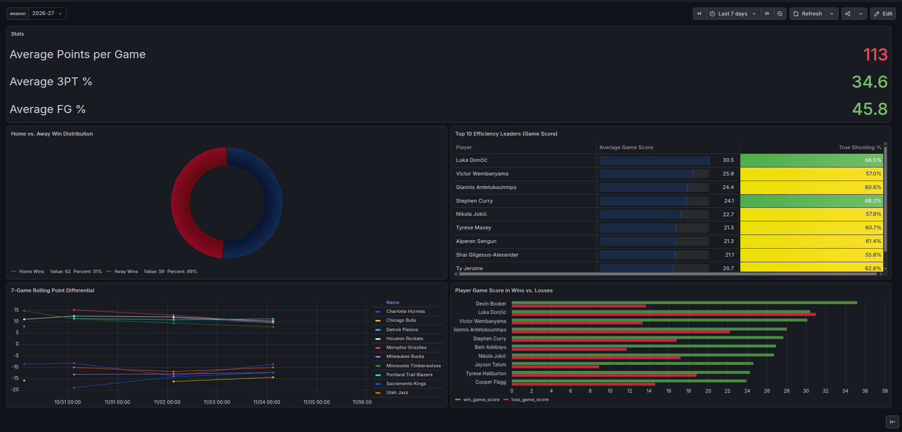
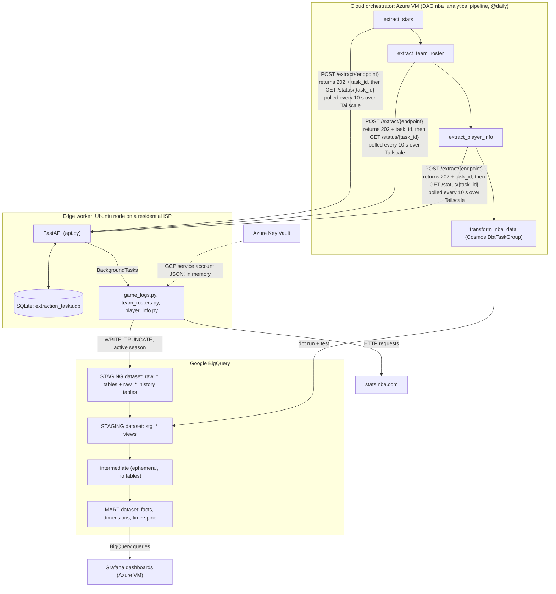
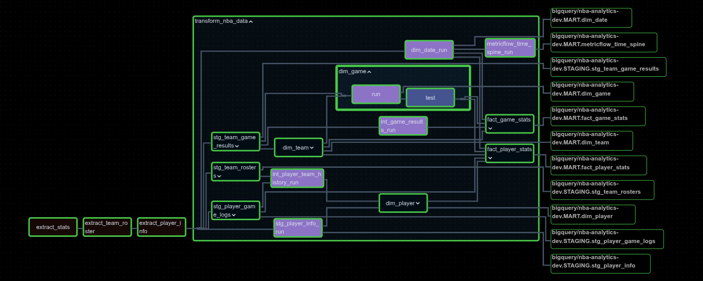
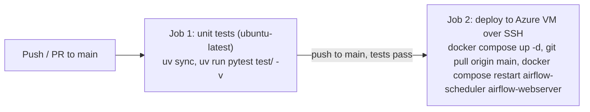
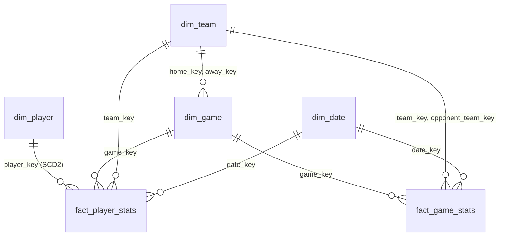

# NBA Analytics Data Pipeline

[](https://github.com/Cliffe16/NBA-Analytics-Pipeline/actions/workflows/ci.yml)                   

An automated **ELT** pipeline that extracts player, roster and game statistics from the **NBA** stats **API** (`stats.nba.com`), loads the raw data into **Google BigQuery**, and transforms it into a dimensional model and **MetricFlow** semantic layer for analytics.

**Contents:** [Overview](#overview) · [Architecture](#architecture) · [Data model](#data-model) · [Tech stack](#tech-stack) · [Repository structure](#repository-structure) · [Execution flow](#pipeline-execution-flow) · [Setup](#setup--installation) · [Season rollover](#operations-season-rollover) · [Design decisions](#design-decisions--challenges) · [Troubleshooting](#troubleshooting--known-issues) · [Data dictionary](#data-dictionary) · [Limitations](#limitations) · [License](#license)

---

## Overview

### Business problem

Build an analytics platform that tracks NBA player and team performance across the season. The model is designed to answer questions like:

| Question | Where it is answered |
|---|---|
| Which players are performing above or below expectations? | `fact_player_stats` (`game_score`, `true_shooting_pct`, `is_season_high_*` flags) |
| How does home court advantage affect team performance? | `fact_game_stats.is_win` split by home/away via `dim_game` |
| What is the relationship between player efficiency and team success? | `fact_player_stats` efficiency metrics joined to `fact_game_stats.is_win` on `game_key` |
| How do player statistics change after trades? | `dim_player` (SCD Type 2 team history) joined to `fact_player_stats` |
| Which teams are trending up or down? | `fact_game_stats` over time via `dim_date` |



*The Grafana "NBA Overview" dashboard, built on the `MART` tables (season 2026-27, last 7 days).*

### Highlights

- **Hybrid cloud-to-edge extraction** that works around WAF blocking of cloud IP ranges.
- **Asynchronous trigger-and-poll** with SQLite task state storage, so long rate-limited extractions never hit gateway timeouts.
- **Cost-aware BigQuery design:** static `_history` tables, `WRITE_TRUNCATE` for the active season, partitioning and clustering.
- **Schema-drift tolerant staging** using `dbt_utils.union_relations`.
- **Dimensional model** with **SCD** Type 2 player history and a MetricFlow semantic layer.
- **Grafana dashboard, provisioned as code,** on the marts: league averages, home vs. away wins, efficiency leaders, rolling point differential, and Game Score in wins vs. losses.
- **Secrets handled in memory** via Azure Key Vault; **CI/CD** with GitHub Actions, `uv` and `pytest`.

**v1 → v2:** v1 was a synchronous pipeline on Snowflake. v2 migrated to BigQuery and was re-architected for reliability and cost. See [Design decisions & challenges](#design-decisions--challenges).

---

## Architecture
 
### Pipeline and execution flow
 


---

Airflow Graph:
 

 
*Airflow graph view of a successful run: the three extraction tasks, then the `transform_nba_data` task group, with dbt models as Cosmos tasks and the test tasks bundled up in the end.*

---
 
### Warehouse layers

---
 
| Layer | Location | Materialization | Purpose |
|---|---|---|---|
| Raw (dbt source `raw`) | `STAGING` dataset: `raw_*` and `raw_*_history` tables | Tables loaded by the edge worker | Landing zone for API payloads |
| Staging | `STAGING` dataset: `stg_*` | Views | Union history and daily tables, rename, cast, deduplicate |
| Intermediate | none | `ephemeral` | Joins and SCD Type 2 history |
| Mart | `MART` dataset | Tables | Facts, dimensions, time spine for BI and MetricFlow |

---
 
### CI/CD

---
 

 
The original v1 architecture diagram (Snowflake, synchronous trigger) is kept in [`docs/pipeline_diagram.png`](docs/pipeline_diagram.png). For comparison, the diagram above is the current v2 architecture.
 
---
 
## Data Model
 
A constellation (fact-constellation) schema: two fact tables sharing conformed dimensions. Surrogate keys for games, players and facts are `STRING`s; `team_key` and `date_key` are `INT64`.
 

 
`dim_game.home_key` and `away_key` reference `dim_team.team_key`. 
`dim_player` is a Slowly Changing Dimension (Type 2). 
Facts resolve to the correct player version with a date-range join on the natural key:
 
```sql
game_date >= effective_start_date AND game_date < effective_end_date
```
 
Column-level detail is in the [Data dictionary](#data-dictionary).
 
---

## Tech Stack

| Layer | Tools |
|---|---|
| Orchestration | Apache Airflow `2.10.0` (LocalExecutor, Docker Compose) |
| Extraction worker | FastAPI, Uvicorn, SQLite, Python `nba_api` |
| Environment management | `uv`, Python `3.12` |
| Secure networking | Tailscale (WireGuard mesh VPN) |
| Secrets management | Azure Key Vault |
| Data warehouse | Google BigQuery |
| Dashboards | Grafana |
| Transformation & semantic layer | dbt-core `1.8.7` (`dbt_utils`), MetricFlow, Astronomer Cosmos |
| CI/CD & testing | GitHub Actions, `pytest`, `appleboy/ssh-action` |


---

## Repository Structure
---

```text
NBA-Analytics-Pipeline/
├── .github/
│   └── workflows/
│       └── ci.yml                       # GitHub Actions CI/CD (uv + pytest + SSH deploy)
├── airflow/                             # Cloud orchestration
│   ├── dags/
│   │   ├── config.py                    # Dynamic project path injection
│   │   └── nba_analytics_pipeline.py    # DAG (async polling & Cosmos DbtTaskGroup)
│   └── webserver_config.py
├── docs/                                # Project documentation & architecture diagrams
│   ├── case_study.md
│   ├── case_study_v2.md
│   ├── airflow_dag_graph.png
│   ├── data_model_diagram.png
│   ├── grafana_dashboard.png
│   └── pipeline_diagram.png             # V1 architecture (Snowflake)
├── extraction/                          # Edge-worker extraction scripts
│   ├── __init__.py
│   ├── config.py                        # Azure Key Vault secret fetcher & API settings
│   ├── game_logs.py                     # PlayerGameLogs & LeagueGameFinder extraction
│   ├── player_info.py                   # Stateful CommonPlayerInfo delta extraction
│   ├── team_rosters.py                  # CommonTeamRoster extraction with snapshot_date
│   └── utils.py                         # In-memory BigQuery client & WRITE_TRUNCATE loader
├── grafana/                             # Grafana provisioning
│   └── provisioning/
│       └── dashboards/
│        │    └── nba_overview.json      # Exported "NBA Overview" dashboard
│        └── datasources/
│             └── bigquery.yaml          
├── nba_analytics/                       # dbt project (BigQuery transformations)
│   ├── analyses/
│   ├── macros/
│   │   └── get_custom_schema.sql        # Custom schema name override macro
│   ├── models/
│   │   ├── staging/                     # Views unioning _history & daily tables + dedup
│   │   │   ├── _sources.yml
│   │   │   ├── _staging_models.yml
│   │   │   ├── stg_player_game_logs.sql
│   │   │   ├── stg_player_info.sql
│   │   │   ├── stg_team_game_results.sql
│   │   │   └── stg_team_rosters.sql
│   │   ├── intermediate/                # Ephemeral models for joins & SCD Type 2 history
│   │   │   ├── int_game_results.sql
│   │   │   └── int_player_team_history.sql
│   │   └── marts/                       # Materialized dimensional models & MetricFlow
│   │       ├── _marts_models.yml
│   │       ├── dim_date.sql
│   │       ├── dim_game.sql
│   │       ├── dim_player.sql
│   │       ├── dim_team.sql
│   │       ├── fact_game_stats.sql
│   │       ├── fact_player_stats.sql
│   │       ├── metricflow_time_spine.sql
│   │       ├── metrics.yml
│   │       └── semantic_models.yml
│   ├── seeds/
│   ├── snapshots/
│   ├── tests/                           # Singular & generic dbt data quality tests
│   │   ├── generic/
│   │   │   ├── assert_data_freshness.sql
│   │   │   ├── test_is_positive.sql
│   │   │   └── valid_season_date.sql
│   │   ├── valid_active_date_ranges.sql
│   │   ├── valid_game_date.sql
│   │   └── valid_shooting_pct.sql
│   ├── dbt_project.yml
│   ├── package-lock.yml
│   ├── packages.yml                     # dbt-labs/dbt_utils dependency
│   └── README.md                        # dbt project notes
├── test/                                # Unit & API verification tests
│   ├── __init__.py
│   ├── test_api.py                      # Pytest suite for FastAPI 202 Accepted polling
│   ├── test_extract_game_logs.py
│   ├── test_utils.py
│   └── verify_api.py
├── .gitignore
├── .python-version                      # Python 3.12
├── api.py                               # Async FastAPI worker with SQLite task tracking
├── docker-compose.yml                   # LocalExecutor Airflow stack with concurrency limits
├── Dockerfile                           # Custom Airflow 2.10.0-python3.12 image
├── LICENSE
├── pyproject.toml                       # uv project configuration & dependencies
├── requirements.txt
├── uv.lock                              # Deterministic uv dependency lockfile
└── README.md
```

---

## Pipeline Execution Flow

1. **Scheduled trigger:** Airflow, running on the Azure VM, triggers the `nba_analytics_pipeline` **DAG** daily (`@daily`, which is 00:00 **UTC** or 03:00 **EAT**).

2. **Remote trigger:** Airflow uses a `PythonOperator` and `HttpHook` to send an **HTTP** `**POST**` across the Tailscale private network to the local FastAPI worker. FastAPI registers a **UUID** `task_id` as `pending` in SQLite, dispatches the extraction in a background task via `BackgroundTasks`, and immediately returns `**HTTP** **202** Accepted`. 
If an extraction of the same type is already `pending` or `running`, the worker returns that task's ID instead of starting a second run.

3. **Extraction:** The local Ubuntu worker retrieves BigQuery service account credentials from Azure Key Vault and initializes the BigQuery client in memory. Because outbound requests to the API originate from a residential ISP, the Akamai WAF permits the connection. 
The three extraction tasks run in sequence, because `extract_player_info` builds its worklist from the `team_roster` and `game_logs` tables that the earlier tasks have just loaded:
    - `game_logs.py`: two bulk calls (`PlayerGameLogs`, `LeagueGameFinder`) for the active season, Regular Season only.
    - `team_rosters.py`: one `CommonTeamRoster` call per team with a 0.6 s delay between calls, plus a `SNAPSHOT_DATE` column.
    - `player_info.py`: delta extraction. It queries BigQuery for players in the roster and game-log tables that are not yet in `raw_player_info`, then calls `CommonPlayerInfo` for each one (1.5 s delay, up to 3 attempts per player). A player that fails all 3 attempts is skipped and retried on the next run, because it is still missing from `raw_player_info`. 5 failures in a row abort the task, since that means the API is blocking requests. Results are saved even when the task aborts.

4. **Direct BigQuery load:** The worker turns each JSON response into a Pandas DataFrame and loads it into the `raw_*` tables of the `**STAGING**` dataset with `WRITE_TRUNCATE` so repeated runs do not accumulate duplicate season-to-date rows. 
The exception is `raw_player_info`, which is appended to (`WRITE_APPEND`) because only players not yet loaded are fetched. 
Every load adds a `LOADED_AT` UTC timestamp so staging models can deduplicate on the real load time (for example, `stg_player_info` keeps the latest row per player). 
Completed seasons are kept in `raw_*_history` tables (see [Season rollover](#operations-season-rollover)).

5. **Status polling:** Airflow polls `**GET** /status/{task_id}` every 10 seconds over Tailscale until the SQLite state becomes `success`, or raises an `AirflowException` on `failed`. 
Each extraction task has a 2-hour `execution_timeout`. When the worker starts, it marks any `pending` or `running` task left over from a crash as `failed: worker restarted`, so Airflow retries instead of polling a dead task.

6. **Transformation:** Once all three extraction tasks succeed, Airflow starts the `transform_nba_data` `DbtTaskGroup`. Astronomer Cosmos compiles and runs the dbt models inside BigQuery, then runs all data tests together once every model has been built (`TestBehavior.AFTER_ALL`). The `stg_*` views union the history and daily tables, and the mart tables are built as partitioned, clustered dimensional models ready for BI consumption.

7. **Dashboards:** Grafana queries the `MART` tables to refresh the "NBA Overview" dashboard.

---

## Setup & Installation

### Prerequisites

- **Cloud:** Azure VM (Ubuntu) with Docker installed, and an Azure Key Vault.
- **Edge node:** Ubuntu machine with Python 3.12 and `uv` installed.
- **Accounts:** Tailscale (free tier), Google Cloud Platform (BigQuery sandbox), Microsoft Azure.

### 1. Cloud orchestrator (Azure VM)

The Airflow environment is containerized. To start it for the first time:

```bash git clone [https://github.com/Cliffe16/**NBA**-Analytics-Pipeline.git](https://github.com/Cliffe16/**NBA**-Analytics-Pipeline.git) cd **NBA**-Analytics-Pipeline sudo docker compose up -d ```

### 2. Airflow connections

Configure these in the Airflow UI:

- `google_cloud_default`: Google Cloud service account connection, used by Cosmos (`GoogleCloudServiceAccountFileProfileMapping`) to build the dbt profile.
- `tailscale`: HTTP connection pointing to the edge worker's Tailscale IP and port.

The DAG file also loads a `.env` (`load_dotenv()`) and expects `DBT_ROOT` (dbt project directory) and `DBT_BIN` (dbt executable), both relative to the project root, plus `GCP_PROJECT_ID`.

The DAG runs the `prod` target (`ProfileConfig(target_name="prod")`). The `dev` target keeps the history tables but limits the current-season table to the last 7 days (in `stg_player_game_logs` and `stg_team_game_results`), which keeps development runs small. The `prod` target is unfiltered. Both targets write to the same BigQuery project and datasets.


### 3. Extraction worker (local Ubuntu node)

Install Tailscale and join the mesh network, then install dependencies:

```bash uv sync ```

Run the FastAPI worker as an always-on `systemd` service (`sudo nano /etc/systemd/system/nba-extraction.service`):

```ini 
[Unit] Description=**NBA** Local Extraction **API** (Tailscale Connection) After=network.target

[Service] User=<user> WorkingDirectory=/path/to/**NBA**-Analytics-Pipeline ExecStart=/path/to/uv run uvicorn api:app --host 0.0.0.0 --port **8000** Restart=always RestartSec=3

[Install] WantedBy=multi-user.target 

```

Set `ExecStart` to the absolute path printed by `command -v uv`. If the path is wrong, systemd fails with `status=**203**/**EXEC**` and keeps restarting the unit.

Enable and start it:

```bash sudo systemctl daemon-reload sudo systemctl enable nba-extraction sudo systemctl start nba-extraction```

### 4. Configuration

`extraction/config.py` reads its secrets from Azure Key Vault at import time using `DefaultAzureCredential`. If a lookup fails, it falls back to an environment variable with the hyphens replaced by underscores, which is how you run locally without Azure.

| Key Vault secret | Fallback env var | Purpose |
|---|---|---|
| `GCP-PROJECT-ID` | `GCP_PROJECT_ID` | BigQuery project |
| `GCP-SERVICE-ACCOUNT` | `GCP_SERVICE_ACCOUNT` | Service account JSON, parsed in memory |  
| `STAGING-DATASET` | `STAGING_DATASET` | Dataset holding the `raw_*` tables and `stg_*` views |
| `ALERT-EMAIL` | `ALERT_EMAIL` | Address for Airflow failure emails (unused unless SMTP is configured) |

Set `VAULT_URL` in `extraction/config.py` to your own vault. Other settings live in the same file: `**SEASON**`, `SEASON_TYPE` (`Regular Season`), `LEAGUE_ID` and `API_DELAY`. 
Without a service account JSON, the BigQuery client falls back to Application Default Credentials.

`DefaultAzureCredential` authenticates the worker to Key Vault: either set `AZURE_CLIENT_ID`, `AZURE_TENANT_ID` and `AZURE_CLIENT_SECRET` for a service principal, or run the worker as a user with a valid `az login` session. 
Secrets are read when the worker starts, so if the credential is missing or expired and no fallback variables are set, the worker fails at startup. `extraction/config.py` does not load a `.env` file itself, so fallback variables must be in the worker's process environment (for example via `EnvironmentFile=` in the systemd unit).

### 5. CI/CD

Deployments are automated by GitHub Actions (`.github/workflows/ci.yml`):

- Every push or pull request to `main` installs `uv`, sets up Python 3.12, syncs dependencies (`uv sync`) and runs the unit tests (`uv run pytest test/ -v`).
- On a push to `main`, if the tests pass, the project is deployed to the Azure VM over **SSH** and the Airflow containers are restarted.

The deploy job needs three repository secrets: `AZURE_HOST`, `AZURE_USER` and `AZURE_SSH_KEY` (the contents of the VM's `.pem` private key).

---

### 6. Business Intelligence & Dashboard-as-Code (DaC)

### 6. Dashboards (Grafana)

I built a BI layer using Grafana on the `MART` model, deployed via **Dashboard-as-Code (DaC)** for strict version control and zero-touch provisioning:

- The exported dashboard is committed as `grafana/provisioning/dashboards/nba_overview.json`.
- When the Docker Compose stack starts on the Azure VM, Grafana installs the BigQuery plugin, provisions the data source from YAML and loads the dashboard, so there is no manual setup in the UI.
- Grafana and Airflow are reached over Tailscale, and the Azure network security group blocks inbound HTTP from the internet.

**[View the Live Executive NBA Dashboard](http://http://100.96.130.48:3000)**

---

## Operations: Season Rollover
 
Completed seasons are archived into the `raw_*_history` tables (`raw_player_game_logs_history`, `raw_team_game_results_history`, `raw_team_rosters_history`). `raw_player_info` has no history table. Archiving is currently a manual procedure:
 
1. In `extraction/config.py`, set `SEASON` to the season being archived.
2. Append the `_history` suffix to the table names being loaded, and in `extraction/utils.py` change the load from `WRITE_TRUNCATE` to `WRITE_APPEND`.
3. Restart the worker: `sudo systemctl restart nba-extraction`.
4. Trigger the `nba_analytics_pipeline` DAG.
5. Revert the table names and load mode, set `SEASON` to the new season, and restart the worker again.
Run the archive once per season: because it uses `WRITE_APPEND`, repeating it duplicates rows in the history tables.

---

## Design Decisions & Challenges

### 1. NBA API blocks cloud IPs → hybrid cloud-to-edge extraction

`stats.nba.com` sits behind an Akamai Web Application Firewall that blocks traffic from major cloud data-center IP ranges. Extraction scripts hosted in the cloud fail with `**HTTP** **403** Forbidden` or time out.

- **Orchestration** runs in the cloud: Apache Airflow on an Azure VM.
- **Extraction** runs on a local Ubuntu machine behind a residential ISP, so requests to the API come from an IP range the WAF accepts.
- **Communication** between Airflow and the worker goes over a Tailscale (WireGuard) mesh **VPN**: encrypted, **NAT**-traversing, and with no ports exposed to the public internet.

### 2. Synchronous HTTP timeouts → asynchronous trigger-and-poll

In v1, synchronous **HTTP** calls timed out during long, rate-limited **API** extractions. v2 replaces `SimpleHttpOperator` with a trigger-and-poll pattern:

- `api.py` returns `**HTTP** **202** Accepted` with a `task_id` and runs the extraction via FastAPI `BackgroundTasks`.
- Task state is persisted in SQLite (`extraction_tasks.db`).
- Airflow polls `**GET** /status/{task_id}` with `HttpHook` until the task succeeds or fails.
- A repeated trigger for a task type that is already running gets the existing `task_id` back, so an Airflow retry never starts two concurrent extractions.
- On startup the worker fails any task left `pending` or `running` by a crash, and each extraction task has a 2-hour `execution_timeout`, so a crash cannot leave Airflow polling forever.

### 3. Warehouse cost: Snowflake → BigQuery and a split storage strategy

In v1, daily `WRITE_APPEND` loads duplicated the full season-to-date payload every day, inflating storage and scan costs. v2:

- Migrated the warehouse from Snowflake to Google BigQuery.
- Archives completed seasons into static `_history` tables and reloads only the active season, using `WRITE_TRUNCATE`.
- Partitions `fact_player_stats` by `game_date` and clusters it by `team_key` and `player_key`, so date- and team-filtered queries prune data.
- Makes intermediate dbt models `ephemeral`, so no extra intermediate tables are stored or maintained.
- In the `dev` target, `stg_player_game_logs` and `stg_team_game_results` keep the history tables but limit the current-season table to the last 7 days, which keeps development runs small. The `prod` target is unfiltered.

A BigQuery dry run of `SELECT *` on `fact_player_stats` filtered to a single `game_date` reports 71.91 KB processed, against 352.98 KB for the full table (about 80% less). At this volume the absolute saving is small, so the partitioning demonstrates the pattern rather than being required.

### 4. API column changes → automated schema-drift handling

`dbt_utils.union_relations` in `stg_team_rosters.sql` inspects `INFORMATION_SCHEMA` and aligns mismatched columns between historical (17 columns) and active-season (18 columns) payloads, replacing a static `**SELECT** *` / `**UNION** **ALL**`.

### 5. Plaintext credentials → in-memory secrets from Azure Key Vault

The worker pulls the GCP service account JSON from Azure Key Vault (`DefaultAzureCredential`, `SecretClient`) and builds credentials in memory (`service_account.Credentials.from_service_account_info`), so no keyfile is ever written to the edge node's disk.

### 6. Flaky API responses → stateful extraction and graceful degradation

`player_info.py` only fetches players that are not yet in `raw_player_info`, retries each request up to 3 times, and skips a player after the third failure. It is picked up again on the next run. Five failures in a row abort the task as an **API** block. In every case the players fetched so far are appended to BigQuery in a `finally` block before exiting.

### 7. Dimensional modeling and a semantic layer

SCD Type 2 player team history is built with window functions (`**LAG**`, `**LEAD**`) over `stg_player_game_logs`, so a new version starts on the date of a player's first game for a new team. Roster snapshots only supply `position` and `jersey_number`, and cover players who have not played yet. A MetricFlow semantic layer (`semantic_models.yml`, `metrics.yml`) exposes standardized metrics for BI.

### 8. Orchestration and delivery

Astronomer Cosmos (`DbtTaskGroup`) runs dbt inside Airflow. The DAG retries each task 3 times at 10-minute intervals and uses `max_active_runs=1` so runs never overlap. A `uv` + `pytest` GitHub Actions workflow tests every change and deploys `main` to the Azure VM.

### 9. Tests ran against stale tables → run all tests after all models

By default, Cosmos creates a `run` and a `test` task for every dbt model, and `dbt test --select dim_game` also selects any test that has `dim_game` as one of its parents. The `relationships` test on `fact_game_stats.game_key` therefore ran in `dim_game`'s test task, before `fact_game_stats` had been rebuilt, and failed with `Got 4930 results, configured to fail if != 0`. The DAG now uses `RenderConfig(test_behavior=TestBehavior.AFTER_ALL)`, which builds every model first and then runs all tests together. The trade-off is that a failing test no longer stops downstream models from building.

---

## Troubleshooting & Known Issues

- **Azure VM memory pressure and `**SIGTERM**` task failures**
    - *Symptom:* concurrent dbt compilation and task execution pushed VM memory to 75–90%, killing tasks with `**SIGTERM**`.
    - *Fix:* use `LocalExecutor` with `AIRFLOW__CORE__PARALLELISM: '2'` and `AIRFLOW__CORE__MAX_ACTIVE_TASKS_PER_DAG: '2'` in `docker-compose.yml`, plus `max_active_runs=1` in the **DAG** definition.

- **`game_logs` fails with `Remote end closed connection without response`**
  - *Symptom:* the worker log shows `Connection aborted` / `RemoteDisconnected` a few milliseconds after `Extracting Player Stats...`, and the task is marked failed.
  - *Cause:* the NBA API (or the firewall in front of it) dropped the connection.
  - *Fix:* none needed in most cases. Airflow retries the task 10 minutes later and the next attempt normally succeeds.

- **Extraction task fails with `Connection refused` to the worker**
    - *Symptom:* the Airflow log shows `HTTPConnectionPool(host='<tailscale-ip>', port=**8000**): Max retries exceeded ... [Errno **111**] Connection refused` for `/extract/<endpoint>`. Once the retries are used up, the task fails and everything downstream is marked `upstream_failed`.
    - *Cause:* nothing is listening on port **8000** on the edge node: the service is stopped, or it cannot start. Repeated `status=**203**/**EXEC**` lines in the journal mean `ExecStart` points to a binary that cannot be executed (wrong path to `uv`). A failed Key Vault login at startup can also stop it.
    - *Fix:* on the edge node, run `systemctl status nba-extraction` and `journalctl -u nba-extraction -n **100**`, resolve the cause, then clear the failed task in Airflow.

---

## Data Dictionary

The `**MART**` dataset in BigQuery exposes these models for BI and downstream analytics.

| Model | Grain | Keys | Notable columns |
|---|---|---|---|
| `fact_player_stats` | One row per player per game | PK `player_fact_key`; FKs `game_key`, `player_key`, `team_key`, `date_key` | Partitioned by `game_date`, clustered by `team_key`, `player_key`. Box score (`minutes_played`, `points`, field goal / three-point / free throw made, attempted and `_pct`, offensive / defensive / total rebounds, `assists`, `steals`, `blocks`, `turnovers`, `personal_fouls`, `plus_minus`), `season_game_number`, advanced metrics `true_shooting_pct` and `game_score`, and `is_season_high_*` flags (points, rebounds, assists, blocks, fouls, steals, 3-pointers, turnovers). |
| `fact_game_stats` | One row per team per game | PK `fact_key`; FKs `game_key`, `team_key`, `opponent_team_key`, `date_key` | `is_win`, `points_scored`, `points_allowed`, `field_goals_pct`, `three_point_pct`, `free_throw_pct`, `total_rebounds`, `assists`, `steals`, `blocks`, `turnovers`. |
| `dim_player` | One row per player version (SCD Type 2) | PK `player_key`; natural key `player_id` | Names, `team_id`, `position`, `jersey_number`, `birth_date`, `height_inches`, `weight_pounds`, `school`, `country`, draft year / round / number. Validity via `effective_start_date`, `effective_end_date`, `is_current`. |
| `dim_team` | One row per franchise | PK `team_key`; `team_id` | `team_abbreviation`, `team_name`; all 30 NBA franchises. |
| `dim_game` | One row per game | PK `game_key`; `game_id` | `game_date`, `season`, derived `season_stage` (`Regular Season`, `Playoffs`, `Preseason`), `home_key` / `away_key` (both reference `dim_team.team_key`). |
| `dim_date` | One row per day, 2020-01-01 to 2030-12-31 | PK `date_key` | `date`, `day_name`, `day_of_week_num`, `day_of_month`, `day_of_year`, `week_of_year`, `month_num`, `month_name`, `year_month`, `quarter_num`, `quarter_name`, `year`, `is_weekend`, `is_weekday`, `nba_season_end_year`. |
| `metricflow_time_spine` | One row per day | `date_day` | Time spine required by MetricFlow. |

Extraction is currently configured for `Regular Season` only (`SEASON_TYPE` in `extraction/config.py`), so playoff and preseason games are not loaded.

**Semantic layer** (`semantic_models.yml`, `metrics.yml`, `metricflow_time_spine.sql`): exposes the `player_stats` semantic model and the metrics `total_points`, `games_played` and `points_per_game`.

### Metric definitions

- **True Shooting %:** `**PTS** / (2 × (**FGA** + 0.44 × **FTA**))`
- **Game Score (Hollinger):** `**PTS** + 0.4×**FGM** − 0.7×**FGA** − 0.4×(**FTA** − **FTM**) + 0.7×**OREB** + 0.3×**DREB** + **STL** + 0.7×**AST** + 0.7×**BLK** − 0.4×PF − **TOV**`

### Data quality

Singular and generic dbt tests in `nba_analytics/tests/` cover data freshness, positive-value checks, valid season and game dates, active date ranges, and shooting-percentage validity. Cosmos runs them as part of `transform_nba_data`.

---

## Limitations

- **Unofficial data source:** `stats.nba.com` is undocumented and can change or rate-limit without notice; the `nba_api` client is community-maintained.
- **Single edge worker:** extraction depends on one machine and one residential connection being online. If the worker is down, the run fails at `extract_stats` with `Connection refused` and the dbt models are skipped.
- **Offseason signings:** a player who changes team in the offseason keeps the previous team in `dim_player` until their first game for the new club, because team history is derived from game logs.
- **Manual season rollover:** archiving a season means editing `extraction/config.py` and `extraction/utils.py` and restarting the worker (see [Season rollover](#operations-season-rollover)).
- **BigQuery sandbox:** tables, views and partitions in sandbox projects expire after 60 days by default, so the append-only `_history` tables need their expiration removed (which means upgrading the project) to be kept permanently.
- **Small data:** a regular season has 1,230 games, which is 2,460 rows in `fact_game_stats` and roughly 25,000 to 30,000 in `fact_player_stats`, so partitioning and clustering show the pattern rather than being needed at this volume.
- **Scope:** built as a portfolio and learning project rather than a hardened production service.


**Disclaimer:** this project is for educational purposes and is not affiliated with or endorsed by the NBA. Review the **NBA**'s terms of use before reusing the data.

---

## License

Distributed under the **MIT** License. See [**LICENSE**](**LICENSE**) for more information.
