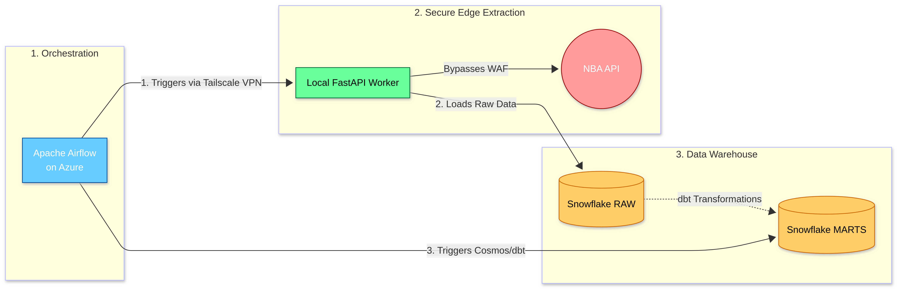
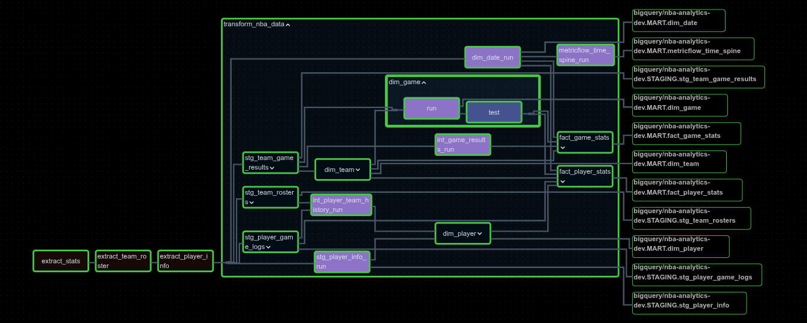
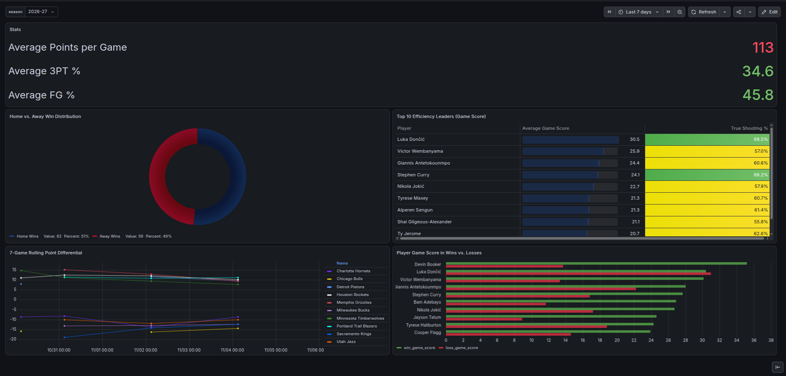

# Outgrowing My First Data Pipeline

*not affiliated with or endorsed by the NBA.*

> **In short:** a daily pipeline that pulls NBA game, roster and player data, loads it into Google BigQuery, models it with dbt into tables and metrics, and serves them on a Grafana dashboard. The NBA's API blocks cloud servers, so Airflow in the cloud tells a worker on my home network to do the extraction.
>
> **Stack:** Apache Airflow, FastAPI, Tailscale, Google BigQuery, dbt (with Astronomer Cosmos), Grafana, Azure, Docker, GitHub Actions.
>
> **Results:** about 550 player API calls on the first run against 0 to 5 on a typical day (over 99% fewer), transient API failures recover through retries with no manual steps and three real failure modes found and fixed, a firewall block, a dbt test race and a service crash loop.

---

### The Business Context

This project started with a clear analytics goal, answering performance questions such as how a player's True Shooting Percentage changes before and after a mid-season trade, or what a team's true home-court win rate is. To answer them reliably, I needed a daily refreshed dimensional model and a semantic layer ready for BI dashboards.

For scale, a regular season has 1,230 games, so `fact_game_stats` gains 2,460 rows per season (one per team per game) and `fact_player_stats` roughly 25,000 to 30,000 (about 20 to 26 player rows per game). 
This is small data. The two archived seasons hold 4,920 team-game rows and 52,957 player-game rows, and as of 6 November the current season added 2,729 player-game rows. 
The hard problems in this project came from the network and the API, not from volume.

The first obstacle appeared as soon as I moved orchestration to the cloud. The NBA's stats API sits behind Firewall that blocks traffic from cloud data-center IP ranges. 
In v1 of this project, I split the system in two: Apache Airflow in an Azure VM, and extraction on a local Ubuntu machine with residential connection. The two talk over a Tailscale mesh VPN, so the worker needs no ports opened to the public internet. The full breakdown is in the [v1 case study](https://github.com/Cliffe16/NBA-Analytics-Pipeline/blob/main/docs/case_study.md).



*v1 architecture: a synchronous trigger over Tailscale, loading into Snowflake.*

v1 solved extraction, but running it day to day exposed new problems: synchronous timeouts, overlapping runs, and storage that grew every day on a Snowflake trial that was about to expire. 
v2 is the response.

### Controlling Storage Growth

In the original Snowflake design, each daily load appended the full season-to-date payload to the warehouse, so the same games were stored again every day, bloating the warehouse with duplicates.

v2 moves the warehouse to Google BigQuery and splits storage into two:
1. **Static archives:** completed seasons live in `_history` tables that are written once, at season rollover.
2. **Active season:** the current season is loaded with `WRITE_TRUNCATE`, so each daily run replaces the previous one instead of adding to it.

Downstream, `fact_player_stats` is partitioned by `game_date` and clustered by `team_key` and `player_key`. At roughly 25,000 to 30,000 rows per season, the table is tiny. With a 10 MB billing minimum, partitioning this table is purely for practice, clustering alone would be enough at this size.


### From Synchronous Calls to Asynchronous Trigger-and-Poll

In v1, the synchronous design caused timeouts during long extractions, due to aggressive rate-limiting from the API, failing Airflow tasks even when the worker eventually succeeded.

v2 replaces this with an asynchronous "trigger-and-poll" pattern. Think of it like ordering food. Instead of waiting at the counter, tying up resources and causing timeouts, Airflow drops off a POST request, receives a tracking number (an `HTTP 202 Accepted` response with a task ID), and steps aside. The local FastAPI worker does the heavy lifting in the background, tracking its own state in a local SQLite database. Airflow simply checks a status endpoint every 10 seconds to see if the job is done.

Splitting a job across two machines creates new failure modes, however, this is how the worker resolves them:

- **Duplicate triggers:** if a task of the same type is already running, the API returns the existing task ID instead of starting a second extraction. An Airflow retry can never cause two concurrent runs.
- **Crash recovery:** on startup, the worker marks any task left `pending` or `running` as `failed: worker restarted`, so Airflow retries instead of polling a dead task.
- **Timeouts and retries:** each extraction task has a two-hour `execution_timeout`, and the DAG retries failed tasks three times at 10-minute intervals.

### Checkpointing the Slowest Extraction

Player biographies (`player_info`) need one API call per player, making them the slowest and most failure-prone extraction. On extraction failure, the script is designed to resume from the last record instead of restarting from scratch.

Before making any API requests, the script queries BigQuery to see which players are already in the warehouse, and it only fetches the missing IDs. If it hits a hard API block (five consecutive failures), it doesn't just crash. A `finally` block saves every player extracted so far, to BigQuery, before the task fails completely. When Airflow retries 10 minutes later, the script resumes where it left off, and staging keeps only the latest row per player, so there are no duplicates downstream.

### The dbt Test Race Condition

I use Astronomer Cosmos to run dbt because it turns each model into its own Airflow task. By default it also creates a `test` sub-task per model, and that caused a failure I did not expect.

`dbt test --select dim_game` also selects any test that has `dim_game` as one of its parents. So the `relationships` test on `fact_game_stats.game_key` ran inside `dim_game`'s test task, before `fact_game_stats` had been rebuilt:

```plaintext
Failure in test relationships_fact_game_stats_game_key__game_key__ref_dim_game_
  Got 4930 results, configured to fail if != 0
```

The numbers explained the failure. `raw_team_game_results_history` held exactly 4,920 team-game rows, which is two full regular seasons (2024-25 and 2025-26), and the 4,930 orphans are those rows plus 10 more from the current season. At the time, the DAG ran against the `dev` target, whose rolling 7-day filter stripped the history out of staging. The freshly rebuilt `dim_game` had lost the history while the not-yet-rebuilt fact table still contained it, so every historical game looked orphaned. I have since changed the `dev` filter to keep the history tables and moved the scheduled run to the `prod` target.

I fixed the race itself with `RenderConfig(test_behavior=TestBehavior.AFTER_ALL)`, which builds every model first and then runs all tests together. The trade-off is that tests no longer stop downstream models from building. A failing test now fails the DAG after the marts are already built.



*The v2 DAG in Airflow: three extraction tasks, then the dbt task group, with one `run` task per model and a single `nba_analytics_test` task at the end.*

### Infrastructure Hurdles

#### Memory Limits

Concurrent dbt compilations pushed RAM above 90%, and Airflow tasks were killed with `SIGTERM`. I limited concurrency through `docker-compose` (`PARALLELISM=2`) and set `max_active_runs=1` on the DAG.

#### API Schema Drift

When the NBA API added a column to the roster payload, 17 columns became 18, the static `UNION ALL` between history and daily tables broke. `dbt_utils.union_relations` now aligns the columns and pads missing ones with `NULL`s. Separately, append loads pass `ALLOW_FIELD_ADDITION`, so a new column does not fail a load into an existing table.

#### The Silent Data Drop

When migrating to BigQuery, I partitioned `fact_player_stats` by `game_date` to optimize query costs. During a full refresh in `prod`, dbt reported successfully scanning 11.8 MiB of historical staging data, but it only inserted 2,700 rows into the final mart, exactly matching the current season. No errors were thrown.

The culprit was the BigQuery Sandbox's mandatory 60-day expiration policy. When a table is partitioned by a date column, BigQuery calculates expiration against the partition's date, not the execution date. Because my historical data was from 2024 and 2025, BigQuery accepted the inserts and then instantly, silently dropped them for being older than 60 days. Removing the partitioning config forced BigQuery to treat the table as a single block expiring 60 days from the run date, successfully recovering all 55,000+ historical rows.

### Data Modeling Trade-offs

To track players changing teams, `dim_player` is a Slowly Changing Dimension (Type 2). My first version built this team history from daily roster snapshots. Then, to save BigQuery storage in v2, I started overwriting the active roster table every day. Because the truncated table is re-stamped with today's `snapshot_date` on every run, a traded player's `effective_start_date` on the new team moved forward to "today" on every run.

I rebuilt the history from `stg_player_game_logs` instead. That anchors each team change to the date of the player's first game for the new team, a date that never moves.

The trade-off is a known edge case. Because history is derived from games played, a player who signs with a new team in July keeps his old team in `dim_player` until his first game with the new team.Since the goal is tracking in-game performance, this is acceptable.

### From Warehouse to Dashboard

To close the loop, I connected Grafana to the marts. The "NBA Overview" dashboard answers the questions this project started with:



- **Who is playing efficiently?** In the dashboard's seven-day window, Luka Dončić leads with an average Game Score of 30.5 and a True Shooting percentage of 68.5%. Victor Wembanyama follows at 25.9, and Stephen Curry's 68.2% is the other elite shooting mark.
- **Does home court matter?** Home teams won 62 of 121 games (51%) in the same window.
- **Which teams are trending?** The 7-game rolling point differential panel separates the strongest and weakest teams at a glance.

These are small samples, a few games per player, so the point here is the plumbing rather than basketball analysis.

The dashboard is provisioned as code from the repository. Docker Compose installs the BigQuery plugin, a provisioning file defines the data source, and the dashboard JSON (`grafana/provisioning/dashboards/nba_overview.json`) is committed, so a fresh deployment needs no manual setup in the UI. I reach Grafana and Airflow over Tailscale, and the scheduled DAG builds the marts with the `prod` target.

The Live Dashboard can be found here: [http://100.96.130.48:3000/](http://100.96.130.48:3000/)

### Results

- **Far fewer API calls:** the first `player_info` run makes about 550 calls to cover every active player on a roster. A typical daily run makes 0 to 5, for newly signed players or call-ups, which cuts the daily load on that endpoint by more than 99%.
- **Resumable extraction:** after a failure, `player_info` continues from the missing players instead of starting over, and the active-season tables are replaced on each run rather than appended to.
- **Retries in practice:** on 4 November the first `game_logs` request was dropped by the API within milliseconds (`Remote end closed connection without response`). The failure reached Airflow, and the retry ten minutes later loaded 2,413 player rows and 214 team rows without any manual step.
- **No concurrent duplicate runs:** the duplicate-trigger guard, crash recovery and timeouts mean a retry or a worker restart should not leave Airflow polling forever or running two extractions at once.
- **A dashboard on the marts:** a Grafana dashboard, provisioned from the repository, reads the production tables.

### What I'd Do Next

- **Alerting:** SMTP is not configured, so a failed run only shows in the Airflow UI. A webhook `on_failure_callback` and a health check on the worker would have caught the crash loop on day one.
- **Season rollover:** archiving a season currently means editing configuration files by hand. Passing the season and an archive mode as API parameters would remove that step.
